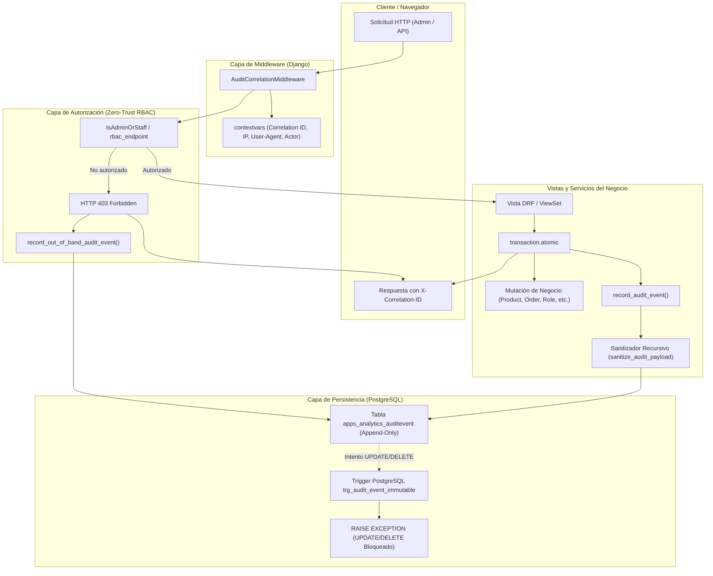

# LEVELPRO OS V4.0 — GATE 1.2: AUDIT TRAIL & ACTIVITY LOG
## DOCUMENTO TÉCNICO 01: ARQUITECTURA DEL SISTEMA DE AUDITORÍA FORENSE INMUTABLE

---

### 1. VISIÓN GENERAL Y OBJETIVOS ARQUITECTÓNICOS

El sistema de auditoría y registro de actividad (**Audit Trail & Activity Log**) de **LEVELPRO OS V4.0** proporciona trazabilidad operacional, forense y de seguridad append-only para todas las mutaciones críticas en la plataforma. Diseñado bajo los estándares de auditoría financiera, e-commerce enterprise y normativas de ciberseguridad, el sistema garantiza:

1. **Inmutabilidad Operacional Multinivel**: Imposibilidad técnica de alterar, sobrescribir o eliminar registros de auditoría tanto a nivel de aplicación (ORM) como a nivel de motor de base de datos (PostgreSQL Trigger).
2. **Atomicidad Transaccional**: Registro síncrono acoplado a la transacción de negocio; si la mutación comercial falla o se revoca, el evento de auditoría correspondiente se revierte atómicamente evitando estados inconsistentes.
3. **Captura Out-of-Band de Eventos de Seguridad**: Registro autónomo de intentos de acceso denegados (HTTP 403) y escalación de privilegios capturados a nivel de middleware sin depender de transacciones de modelo.
4. **Propagación de Trazabilidad Distribuida**: Generación e inyección de encabezado `X-Correlation-ID` mediante `contextvars` de Python, vinculando todas las operaciones originadas por una misma solicitud HTTP o proceso batch.
5. **Sanitización y Segregación RBAC en Origen**: Sanitización recursiva de secretos antes de la persistencia y enmascaramiento dinámico de datos financieros en lectura según los permisos del consultante.

---

### 2. DIAGRAMA ARQUITECTÓNICO DEL FLUJO DE AUDITORÍA



---

### 3. COMPONENTES NÚCLEO DE LA ARQUITECTURA

#### 3.1. Propagación de Contexto Forense (`core/audit/context.py`)
Utiliza `contextvars.ContextVar` nativo de Python para aislar el contexto de ejecución por solicitud concurrente:
- `_correlation_id_ctx`: UUID v4 único generado o heredado del header `X-Correlation-ID`.
- `_actor_ctx`: Instancia resuelta del usuario autenticado.
- `_ip_address_ctx`: Dirección IP del cliente (`REMOTE_ADDR` o cabeceras de proxy inverso).
- `_user_agent_ctx`: Cadena User-Agent del navegador o cliente API.

#### 3.2. Middleware de Correlación y Auditoría Denegada (`core/audit/middleware.py`)
`AuditCorrelationMiddleware` intercepta todas las solicitudes entrantes y salientes:
1. Extrae o genera el `correlation_id`.
2. Asocia los metadatos de red a `contextvars`.
3. Inyecta `X-Correlation-ID` en los headers de la respuesta HTTP.
4. Si la respuesta resulta en `HTTP 403 Forbidden` sobre una ruta administrativa (`/api/v1/admin/`, `/api/v1/billing/`, `/api/schema/`), invoca de forma autónoma `record_out_of_band_audit_event()` registrando la categoría `security_denied`.

#### 3.3. Sanitizador Recursivo de Secretos (`core/audit/sanitizer.py`)
Antes de persistir cualquier diccionario en `previous_values`, `new_values` o `metadata`:
- Recorre recursivamente estructuras anidadas (`dict`, `list`, `tuple`) hasta una profundidad de 8 niveles.
- Compara claves contra una lista negra estricta (`password`, `token`, `secret`, `cvv`, `authorization`, `cookie`, `key`, `private_key`).
- Reemplaza cualquier coincidencia por la constante `"[REDACTED_SECRET]"`.
- Convierte instancias de `Decimal` a representaciones canónicas de cadena fija con 2 decimales para evitar discrepancias de serialización JSON.

#### 3.4. Servicio Central de Registro (`core/audit/services.py`)
Proporciona dos funciones principales:
1. `record_audit_event(...)`: Ejecución síncrona dentro del hilo de trabajo. Por defecto se ejecuta dentro de la transacción activa (`mandatory=True`), garantizando reversibilidad en fallos.
2. `record_out_of_band_audit_event(...)`: Registro desacoplado con aislamiento de excepción; nunca interrumpe el flujo principal si el registro colateral falla.

---

### 4. MODELO DE DATOS INMUTABLE (`AuditEvent`)

Definido en `backend/apps/analytics/models.py`:

```python
class AuditEvent(TimeStampedModel):
    id = models.UUIDField(primary_key=True, default=uuid.uuid4, editable=False)
    created_at = models.DateTimeField(auto_now_add=True, db_index=True)
    
    actor = models.ForeignKey(settings.AUTH_USER_MODEL, on_delete=models.SET_NULL, null=True, blank=True)
    actor_email = models.EmailField(max_length=255, blank=True, db_index=True)
    actor_username = models.CharField(max_length=150, blank=True)
    actor_type = models.CharField(max_length=30, default="staff")
    actor_roles = models.JSONField(default=list, blank=True)
    
    module = models.CharField(max_length=50, db_index=True)
    action = models.CharField(max_length=80, db_index=True)
    event_category = models.CharField(max_length=40, db_index=True)
    
    resource_type = models.CharField(max_length=60, db_index=True)
    resource_id = models.CharField(max_length=255, db_index=True)
    resource_repr = models.CharField(max_length=255, blank=True)
    
    result = models.CharField(max_length=20, default="success", db_index=True)
    severity = models.CharField(max_length=20, default="info", db_index=True)
    
    previous_values = models.JSONField(default=dict, blank=True)
    new_values = models.JSONField(default=dict, blank=True)
    changed_fields = models.JSONField(default=list, blank=True)
    
    correlation_id = models.CharField(max_length=64, blank=True, db_index=True)
    source = models.CharField(max_length=30, default="api")
    ip_address = models.GenericIPAddressField(null=True, blank=True)
    user_agent = models.TextField(blank=True)
    metadata = models.JSONField(default=dict, blank=True)
    schema_version = models.PositiveSmallIntegerField(default=1)
```

---

### 5. DOBLE BARRERA DE INMUTABILIDAD OPERACIONAL

| Nivel | Mecanismo | Comportamiento ante Intento de Alteración |
|---|---|---|
| **Nivel 1: Aplicación / ORM** | `AuditEventQuerySet` & `AuditEventManager` | `update()`, `delete()`, `bulk_update()` lanzan `django.core.exceptions.PermissionDenied` con el mensaje: *"Operación prohibida: Los registros de AuditEvent son estrictamente inmutables (append-only)."* |
| **Nivel 1: Instancia ORM** | `AuditEvent.save()` & `delete()` | `save()` verifica `if self.pk and not self._state.adding:` y lanza `PermissionDenied`. `delete()` lanza `PermissionDenied` inmediatamente. |
| **Nivel 2: Motor PostgreSQL** | Función PL/pgSQL `prevent_audit_event_mutation()` | Trigger `BEFORE UPDATE OR DELETE ON apps_analytics_auditevent` ejecuta `RAISE EXCEPTION 'Operación prohibida: Los eventos de auditoría son inmutables...' USING ERRCODE = 'restrict_violation';` |

Esta arquitectura garantiza que ni desarrolladores mediante Django ORM ni administradores de base de datos ejecutando sentencias SQL accidentales puedan alterar la evidencia forense histórica de la plataforma.
