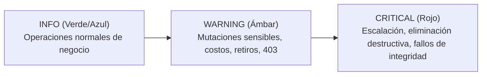

# LEVELPRO OS V4.0 — GATE 1.2: AUDIT TRAIL & ACTIVITY LOG
## DOCUMENTO TÉCNICO 02: TAXONOMÍA ESTANDARIZADA DE EVENTOS Y CATÁLOGO FORENSE

---

### 1. PRINCIPIOS DE CLASIFICACIÓN TAXONÓMICA

La taxonomía de eventos de auditoría de **LEVELPRO OS V4.0** estandariza la clasificación semántica de todas las mutaciones y eventos de seguridad. Esto permite consultas estructuradas, alertas en tiempo real, agregaciones de KPIs y segregación RBAC sin ambigüedad.

La taxonomía está gobernada por las constantes declaradas en `backend/core/audit/constants.py`.

---

### 2. MATRIZ DE CATEGORÍAS DE EVENTOS (15 CATEGORÍAS)

| Clave de Categoría | Etiqueta Oficial en Español | Nivel Típico de Severidad | Módulos Principales | Descripción Funcional |
|---|---|---|---|---|
| `creation` | Creación de Entidad | `info` | Catalog, Academy, Services, Rewards | Alta de un nuevo recurso en la base de datos (producto, curso, servicio, campaña). |
| `modification` | Modificación de Datos | `info` | Todos | Actualización de atributos generales o editoriales de una entidad. |
| `deletion` | Eliminación de Entidad | `warning` | Catalog, Academy, Services, Finances | Eliminación física o lógica de un recurso del sistema. |
| `price_change` | Cambio de Precio de Venta | `info` | Catalog | Modificación del precio comercial de un producto o servicio para clientes. |
| `cost_change` | Cambio de Costo de Adquisición | `warning` | Catalog, Purchases | Alteración del costo de compra/proveedor. Sensible comercialmente. |
| `stock_adjustment` | Ajuste de Inventario | `info` / `warning` | Inventory, Warehouse | Variación del stock físico disponible o existencias mínimas. |
| `order_status` | Transición de Estado de Orden | `info` | Orders, Logistics | Cambio de estado de un pedido (`pending` → `paid` → `shipped` → `completed`). |
| `payment_operation` | Operación de Pago | `info` / `warning` | Payments | Aprobación, rechazo, cancelación o conciliación manual de pagos. |
| `financial_operation` | Operación Financiera | `warning` / `critical` | Finances, Billing | Ejecución de retiros de utilidades, reasignación de categorías o registro SII. |
| `config_change` | Cambio de Configuración | `warning` | Settings, Loyalty | Modificación de tasas de cambio (FX), banners globales o reglas de lealtad. |
| `role_permission` | Asignación de Rol o Permiso | `info` / `warning` | Roles, Security | Concesión o revocación de roles empresariales a usuarios del staff. |
| `bulk_operation` | Operación Masiva | `warning` | Catalog, Academy | Importación masiva de productos, marcas o cursos vía CSV. |
| `export` | Exportación de Datos | `info` | Audit, Orders, Rewards | Descarga de registros a archivos CSV o reportes externos. |
| `security_denied` | Acceso Denegado (403) | `warning` | Security Core, API | Intento de acceso a un endpoint protegido sin las credenciales o capacidades. |
| `privilege_escalation` | Intento de Escalación | `critical` | Roles, Security Core | Detección de auto-asignación de roles superiores o manipulación de permisos. |

---

### 3. ESCALA DE SEVERIDAD



1. **`info`**: Operaciones cotidianas legítimas autorizadas (ej. actualización de stock, cambio de estado de orden, creación de producto).
2. **`warning`**: Operaciones con impacto financiero o de seguridad moderado (ej. cambio de costo de adquisición, retiros monetarios, solicitud HTTP 403 denegada, rechazo de pago).
3. **`critical`**: Intentos de escalación de privilegios no autorizados, fallos de integridad o violación de políticas SoD (Segregación de Funciones).

---

### 4. RESULTADOS DE OPERACIÓN

- **`success`**: La mutación fue procesada, autorizada y persistida satisfactoriamente en la base de datos.
- **`denied`**: La operación fue rechazada por la capa de seguridad RBAC o las políticas de negocio (HTTP 403 / 401).
- **`error`**: La operación fue abortada por una excepción interna o validación de integridad (HTTP 400 / 500).

---

### 5. FUENTES Y ORÍGENES DE EVENTOS (`source`)

- **`api`**: Solicitud entrante a la API REST autenticada mediante tokens o sesión web.
- **`admin_ui`**: Acción iniciada interactivamente desde la consola administrativa LEVELPRO OS.
- **`script`**: Ejecución mediante script de soporte o tarea de migración.
- **`cron`**: Tarea programada o worker asíncrono en segundo plano.
- **`webhook`**: Evento originado por una pasarela externa (MercadoPago, PayPal, SoundMap).
- **`system`**: Operación generada internamente por señales del sistema o triggers.

---

### 6. ESQUEMA ESTÁNDAR DEL PAYLOAD DE AUDITORÍA

Cada evento serializado sigue la especificación estructurada JSON:

```json
{
  "id": "e1f0718f-a034-404a-81d1-750b9f5d9aa4",
  "created_at": "2026-11-20T19:45:00.123456Z",
  "actor": {
    "id": "u-9942",
    "email": "gerencia@levelpro.cl",
    "username": "gerencia",
    "type": "staff",
    "roles": ["Gerencia / Administración"]
  },
  "module": "catalog",
  "action": "PRICE_CHANGED",
  "event_category": "price_change",
  "category_label": "Cambio de Precio de Venta",
  "resource_type": "Product",
  "resource_id": "421",
  "resource_repr": "Shure SM7B Vocal Dynamic Microphone",
  "result": "success",
  "result_label": "Exitoso",
  "severity": "info",
  "severity_label": "Información",
  "previous_values": {
    "price": "429990.00"
  },
  "new_values": {
    "price": "459990.00"
  },
  "changed_fields": ["price"],
  "correlation_id": "a6b107ec-d278-43bb-a801-b54133497d51",
  "source": "api",
  "ip_address": "192.168.1.105",
  "user_agent": "Mozilla/5.0 (Macintosh; Intel Mac OS X 10_15_7)...",
  "metadata": {},
  "schema_version": 1,
  "financial_masked": false
}
```
