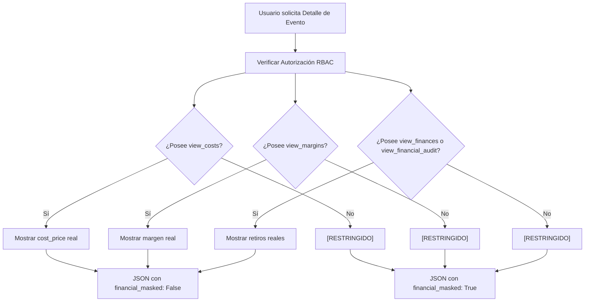

# LEVELPRO OS V4.0 — GATE 1.2: AUDIT TRAIL & ACTIVITY LOG
## DOCUMENTO TÉCNICO 05: PROTECCIÓN DE DATOS SENSIBLES, ENMASCARAMIENTO Y POLÍTICA DE RETENCIÓN

---

### 1. POLÍTICA DE SEGURIDAD PARA DATOS SENSIBLES

En cumplimiento con los requerimientos de **GATE 1.1** y **GATE 1.2**, el registro de auditoría nunca debe convertirse en un vector de fuga de información clasificada o credenciales. Se aplican dos capas ortogonales de protección:

1. **Sanitización Estricta en Ingesta (Write-Time)**: Destrucción irreversible de secretos y credenciales antes de ser almacenados en base de datos.
2. **Enmascaramiento Dinámico en Lectura (Read-Time)**: Ocultamiento condicionado por rol (RBAC) de costos, márgenes y cifras financieras.

---

### 2. SANITIZACIÓN RECURSIVA EN INGESTA (`sanitize_audit_payload`)

Antes de persistir cualquier diccionario en `previous_values`, `new_values` o `metadata`, la función `sanitize_audit_payload()` procesa el payload recursivamente hasta 8 niveles de profundidad.

#### Lista Negra de Claves Sensibles:
- `password`, `contraseña`, `passwd`
- `token`, `access_token`, `refresh_token`, `jwt`
- `secret`, `api_secret`, `client_secret`
- `cvv`, `cvc`, `security_code`, `card_number`
- `authorization`, `cookie`, `set-cookie`
- `private_key`, `secret_key`, `api_key`

Cualquier valor asociado a estas claves es reemplazado por la constante:
```json
"[REDACTED_SECRET]"
```

---

### 3. ENMASCARAMIENTO DINÁMICO POR ROL (`mask_payload_financial_data`)

A diferencia de los secretos técnicos, los datos financieros (costos de adquisición, márgenes brutos, montos de retiros) deben almacenarse fielmente para fines de auditoría forense interna, pero deben ser **ocultados en tiempo de lectura** a los usuarios que carecen de los permisos correspondientes.



#### Claves Afectadas por Permiso:
- **`view_costs`**: `cost_price`, `cost`, `costo`, `total_cost`, `costo_total`, `capital_cost`, `valor_inventario`.
- **`view_margins`**: `margin`, `margen`, `profit`, `ganancia`, `utilidad`, `net_profit`.
- **`view_finances` / `view_financial_audit`**: `withdrawal_amount`, `distributions`.

Cuando un usuario sin estos permisos consulta un evento, el campo se sustituye por `"[RESTRINGIDO]"` y la respuesta API incluye `"financial_masked": true`, activando en el frontend el distintivo visual de restricción RBAC.

---

### 4. POLÍTICA INSTITUCIONAL DE RETENCIÓN DE REGISTROS

1. **Período de Retención Activa (Hot Storage)**:
   - Variable de entorno configurable: `AUDIT_RETENTION_DAYS = env.int("AUDIT_RETENTION_DAYS", default=365)`.
   - Por defecto: 365 días (1 año calendario) de retención en línea accesible directamente desde el Activity Center y la API REST.
2. **Ciclo de Vida y Archivo Frío (Cold Storage)**:
   - Para registros con antigüedad superior a 365 días, la arquitectura prevé la exportación masiva estructurada a almacenamiento inmutable de objetos (Cloud Storage Archive con retención de bloqueo WORM) antes de la purga programada.
   - En esta fase (Gate 1.2), ningún registro histórico es eliminado automáticamente para asegurar trazabilidad acumulada completa.
