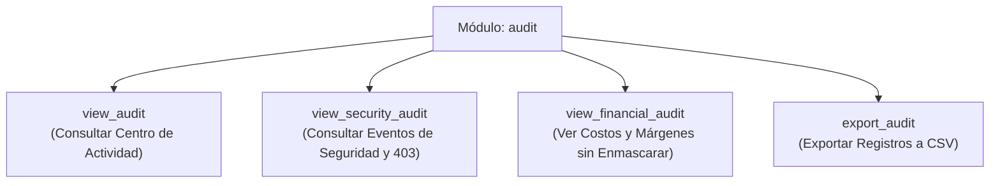

# LEVELPRO OS V4.0 — GATE 1.2: AUDIT TRAIL & ACTIVITY LOG
## DOCUMENTO TÉCNICO 07: INTEGRACIÓN CON EL SISTEMA RBAC GRANULAR Y SEGREGACIÓN SoD

---

### 1. MODELADO DEL MÓDULO DE AUDITORÍA EN RBAC

Para integrar armónicamente el sistema de auditoría con la matriz de control de acceso establecida en **GATE 1.1**, se incorporó el módulo oficial `MODULE_AUDIT = "audit"` en `backend/core/rbac/constants.py`.

El módulo cuenta con un conjunto de 4 capacidades sensibles especializadas, elevando el catálogo total de la plataforma a **16 capacidades sensibles** y **13 módulos empresariales**.

---

### 2. CAPACIDADES SENSIBLES DEL MÓDULO AUDIT

1. **`view_audit`**: Permite al usuario acceder al Activity Center, consultar la tabla de eventos, visualizar estadísticas y abrir el detalle general de mutaciones operativas.
2. **`view_security_audit`**: Permite acceder y filtrar eventos clasificados de seguridad (`role_permission`, `security_denied`, `privilege_escalation`). Oculto por defecto para roles puramente contables o comerciales.
3. **`view_financial_audit`**: Autoriza la visualización íntegra de campos monetarios, costos unitarios, márgenes de utilidad y montos de retiro dentro del modal de diferencias de estado. Sin esta capacidad, dichos valores se enmascaran automáticamente como `[RESTRINGIDO]`.
4. **`export_audit`**: Autoriza la generación y descarga masiva de archivos CSV forenses.

---

### 3. ASIGNACIÓN EN LA MATRIZ MAESTRA DE ROLES (`DEFAULT_ROLE_MATRIX`)

| Rol Empresarial | Acceso a Módulo `audit` | `view_audit` | `view_security_audit` | `view_financial_audit` | `export_audit` | Acciones Permitidas |
|---|---|---|---|---|---|---|
| **Super Admin** | **Sí** | **Sí** | **Sí** | **Sí** | **Sí** | `read`, `export` |
| **Gerencia / Administración** | **Sí** | **Sí** | **Sí** | **Sí** | **Sí** | `read`, `export` |
| **Finanzas / Contabilidad** | **Sí** | **Sí** | **No (SoD)** | **Sí** | **Sí** | `read`, `export` |
| **Ventas** | No | No | No | No | No | Ninguna (Denegado) |
| **Compras** | No | No | No | No | No | Ninguna (Denegado) |
| **Bodega** | No | No | No | No | No | Ninguna (Denegado) |
| **Logística** | No | No | No | No | No | Ninguna (Denegado) |
| **Marketing** | No | No | No | No | No | Ninguna (Denegado) |
| **Academia** | No | No | No | No | No | Ninguna (Denegado) |
| **Soporte Técnico** | No | No | No | No | No | Ninguna (Denegado) |

---

### 4. SEGREGACIÓN DE FUNCIONES (SoD) EN AUDITORÍA

La asignación respeta estrictamente los principios de Segregación de Funciones:

1. **Finanzas vs. Seguridad Operativa**:
   El rol `Finanzas / Contabilidad` requiere auditar pagos, retiros y documentos tributarios (`view_financial_audit`), pero **NO** tiene visibilidad de las auditorías de seguridad, asignación de roles de staff ni intentos de escalación de privilegios (`view_security_audit`).
2. **Roles Operativos vs. Auditoría General**:
   Roles como `Ventas` o `Bodega` ejecutan mutaciones (crear órdenes, ajustar stock) pero no pueden acceder al registro centralizado de auditoría, previniendo la manipulación o reconocimiento de patrones forenses.
3. **Idempotencia de `setup_rbac`**:
   El comando `setup_rbac` aprovisiona los 16 permisos sensibles y asigna las capacidades de auditoría de forma aditiva y segura, respetando revocaciones deliberadas efectuadas por el Super Admin.
