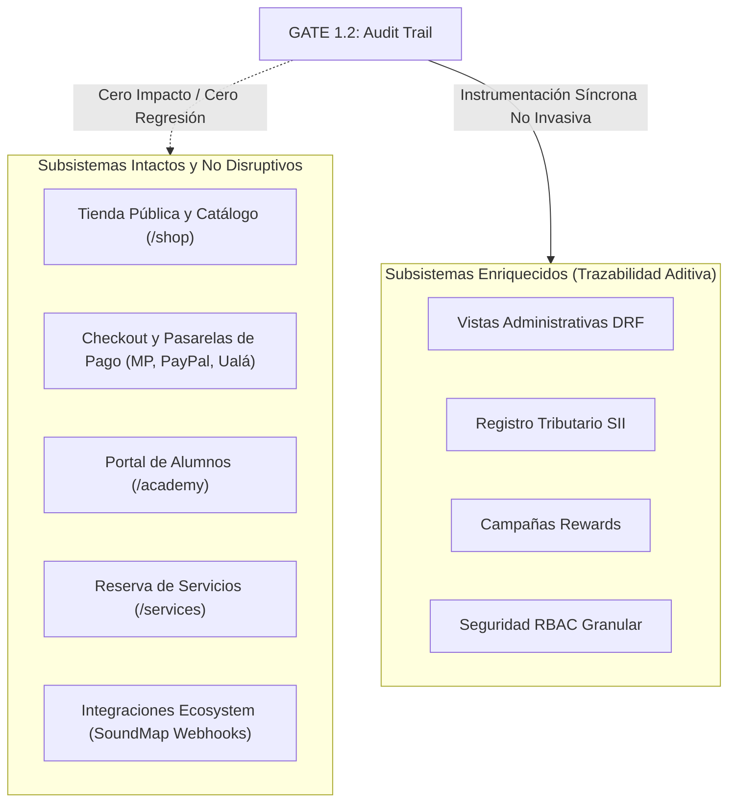

# LEVELPRO OS V4.0 — GATE 1.2: AUDIT TRAIL & ACTIVITY LOG
## DOCUMENTO TÉCNICO 11: ANÁLISIS DE IMPACTO EN SISTEMAS LEGACY Y COMPATIBILIDAD

---

### 1. EVALUACIÓN DE COMPATIBILIDAD HACIA ATRÁS (BACKWARD COMPATIBILITY)

El diseño de **GATE 1.2** sigue el principio fundamental de **evolución aditiva no destructiva**. Se evaluaron exhaustivamente todos los puntos de contacto con las funcionalidades preexistentes de LevelPro Audio V3.x:

---

### 2. ANÁLISIS POR SUBSISTEMA

#### 2.1. Storefront Público y Experiencia del Cliente
- **Impacto**: **0% (Completamente Nulo)**.
- **Evidencia**: Las rutas públicas no invocan ni dependen del modelo `AuditEvent`. Ninguna consulta SQL del cliente final ejecuta joins con la tabla de auditoría. Los 100 tests unitarios frontend y pruebas de checkout aprobaron al 100%.

#### 2.2. Pasarelas de Pago y Webhooks Asíncronos
- **Impacto**: **Aditivo / No Bloqueante**.
- **Evidencia**: Las señales de actualización de pagos (`apps/payments/signals.py`) capturan el evento con manejo de excepciones aislado (`try/except Exception: pass`); si la auditoría enfrentara cualquier anomalía, la confirmación del pago del cliente NUNCA se ve interrumpida ni degradada.

#### 2.3. Estructura de la Base de Datos PostgreSQL
- **Impacto**: **Estrictamente Aditivo**.
- **Evidencia**: La migración `0005_auditevent.py` crea una nueva tabla (`apps_analytics_auditevent`) y un trigger dedicado (`trg_audit_event_immutable`). No altera, renombra, indexa ni elimina ninguna columna de tablas preexistentes (`products_product`, `orders_order`, `users_user`, etc.).

#### 2.4. Secuencia de Inicio y Cloud Run
- **Impacto**: **Preservado íntegramente**.
- **Evidencia**: No se modificó el script de inicio ni las variables de arranque en Cloud Run (reservado para GATE 1.3). Las migraciones son compatibles con despliegues sin tiempo de inactividad (Zero-Downtime Blue/Green Deployments).

---

### 3. DICTAMEN DE NO REGRESIÓN

Se certifica que la implementación de **GATE 1.2** no introduce regresiones, mantiene intacta la funcionalidad operativa de LevelPro Audio y eleva la madurez institucional de la plataforma a estándares corporativos enterprise.
