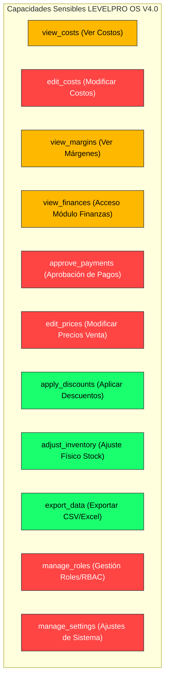
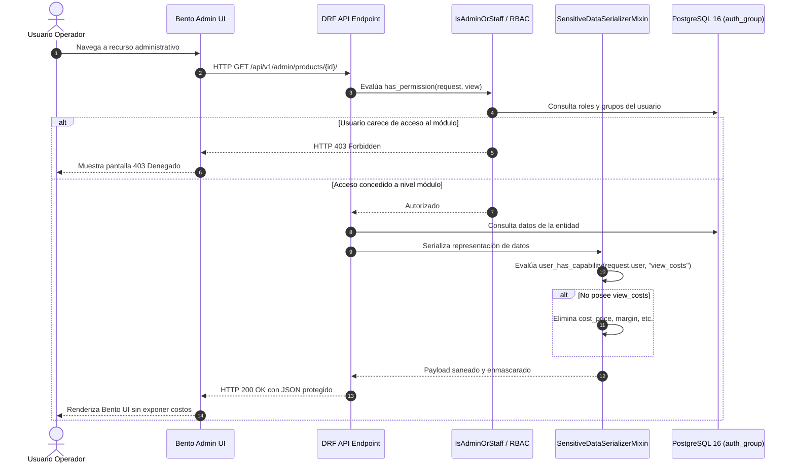

# LEVELPRO OS V4.0 — GATE 1.1: RBAC ARCHITECTURE SPECIFICATION
## Documento 01: Arquitectura del Core de Seguridad y Control de Acceso Granular

**Estado:** Certificado  
**Versión:** 1.0  
**Fecha:** 20 de Noviembre, 2026  
**Rama:** `feature/v4-gate1-business-core`  
**Commit Base:** `2c7a2a3` (Gate 1.0 Baseline Certified)  
**Ambiente:** Python 3.11.18 / Django 5.2.16 / PostgreSQL 16.13 / Docker  

---

### 1. Resumen Ejecutivo y Misión Arquitectónica

LEVELPRO OS V4.0 evoluciona el esquema de autenticación y autorización previo (basado en flags binarios `is_staff` / `is_superuser`) hacia un modelo formal de **Control de Acceso Basado en Roles (RBAC Granular)** con segregación estricta de funciones comerciales, operativas y financieras.

La arquitectura se diseñó bajo los siguientes axiomas innegociables:
1. **Denegación por Defecto (Zero Trust):** Ningún usuario, staff ni operador dispone de acceso a recursos o módulos no autorizados explícitamente en su matriz de roles.
2. **Defensa en Profundidad (Defense-in-Depth):** La autorización se valida en cuatro capas desacopladas:
   - Capa de Enrutamiento / Proxy (Nginx)
   - Capa de Permisos DRF (`IsAdminOrStaff`, `RBACPermission`, `HasModulePermission`)
   - Capa de Serialización y Transformación de Datos (`SensitiveDataSerializerMixin`)
   - Capa de Interfaz Administrativa (Bento UI con renderizado condicional por rol)
3. **No Disruptividad en PostgreSQL:** Se aprovecha el modelo relacional nativo `django.contrib.auth.models.Group` y `Permission` ya presente en el schema de `apps.users.User`, evitando migraciones destructivas sobre la tabla `users_user`.
4. **Antiescalada de Privilegios:** Ningún operador que carezca de rol de Super Admin puede atribuirse privilegios elevados a sí mismo o a terceros. Se incluye protección estricta contra la revocación del último superusuario activo.

---

### 2. Taxonomía de Módulos Operativos (12 Módulos)

El sistema segmenta las operaciones de negocio en 12 dominios estandarizados (`MODULE_*` en `backend/core/rbac/constants.py`):

| Identificador de Módulo | Nombre Funcional | Dominio Operativo / Gates Relacionados |
| :--- | :--- | :--- |
| `dashboard` | Dashboard Ejecutivo | Visión global consolidada, KPIs transaccionales (Gate 0, 13) |
| `catalog` | Catálogo de Productos | Fichas técnicas, categorías, marcas, SEO (Gate 2) |
| `orders` | Órdenes y Ventas | Flujo de pedidos, estados de entrega, B2B quotes (Gate 7) |
| `inventory` | Inventario y Stock | Control de existencias, serialización, alertas mínimas (Gate 4) |
| `purchases` | Compras y Proveedores | Órdenes de compra, costos de adquisición landed (Gate 3, 5) |
| `logistics` | Despacho y Logística | Transportistas, guías de despacho, tracking (Gate 10) |
| `finances` | Finanzas y Tesorería | Conciliación bancaria, categorías, retiros, flujos (Gate 9) |
| `marketing` | Fidelización y Rewards | Campañas, cupones, tickets de sorteos (Gate 14) |
| `academy` | Academia y Cursos | Cursos pro audio, módulos, lecciones, certificaciones (Gate 14) |
| `services` | Servicios Profesionales | Agendamiento, cotizaciones acústicas y de calibración (Gate 14) |
| `roles` | Seguridad y RBAC | Gestión de usuarios, grupos, auditoría y permisos (Gate 1.1) |
| `settings` | Configuración Global | Identidad visual, variables del sitio, pasarelas (Gate 11, 12) |

---

### 3. Taxonomía de Capacidades Sensibles (11 Capacidades)

Las capacidades sensibles protegen acciones de alto riesgo que no deben concederse genéricamente a cualquier miembro de un módulo:

---

### 4. Estructura de los 10 Roles Empresariales Oficiales

1. **Super Admin:** Control técnico e institucional irrestricto de toda la plataforma. Acceso total a los 12 módulos y las 11 capacidades.
2. **Gerencia / Administración:** Dirección operativa, comercial y financiera integral. Posee acceso a todos los módulos salvo gestión interna de seguridad del sistema.
3. **Ventas:** Atención comercial, catálogo, órdenes y cotizaciones. Posee la capacidad sensible `apply_discounts`. Tiene denegado de forma estricta el acceso a finanzas y enmascaramiento total de costos (`cost_price`).
4. **Compras:** Proveedores, adquisiciones y control de costos de entrada. Posee `view_costs`, `edit_costs` y `export_data`.
5. **Bodega:** Control físico de almacén, existencias y despachos. Posee la capacidad `adjust_inventory`.
6. **Logística:** Despachos, transportistas y tracking de pedidos.
7. **Finanzas / Contabilidad:** Tesorería, conciliación bancaria, estados de resultado, cálculo de márgenes y auditoría de costos. Posee `view_finances`, `view_costs`, `view_margins`, `approve_payments`, `export_data`.
8. **Marketing:** Contenido, fidelización Rewards, cupones y banners. Posee `apply_discounts` y `manage_settings`.
9. **Academia:** Cursos técnicos, módulos, lecciones, rutas de certificación e inscripciones.
10. **Soporte Técnico:** Posventa, garantías, seguimiento de casos y notas técnicas.

---

### 5. Flujo de Validación de Acceso

